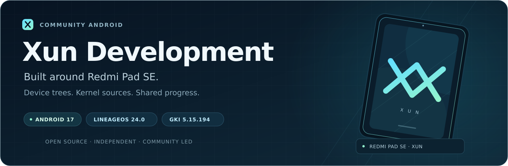

<p align="center">
  
</p>

<p align="center">
  <a href="https://github.com/Xun-Development/local_manifests/tree/lineage-24.0"><strong>Build guide</strong></a>
  &nbsp; · &nbsp;
  <a href="https://github.com/orgs/Xun-Development/repositories?type=all"><strong>Explore sources</strong></a>
  &nbsp; · &nbsp;
  <a href="https://github.com/Xun-Development/local_manifests/blob/lineage-24.0/AUDIT_XUN.md"><strong>Stability audit</strong></a>
  &nbsp; · &nbsp;
  <a href="https://github.com/Xun-Development/local_manifests/issues/new/choose"><strong>Report an issue</strong></a>
</p>

We maintain community Android sources for **Xiaomi Redmi Pad SE (`xun`)**: device configuration, vendor files, kernel materials and shared Android components.

**Current source target:** Android 17 · LineageOS 24.0 · GKI 5.15.194

> [!IMPORTANT]
> **Device validation is pending.** Source fixes and targeted checks are documented in the [xun audit](https://github.com/Xun-Development/local_manifests/blob/lineage-24.0/AUDIT_XUN.md). A full xun OTA rebuild and runtime testing on a tablet are still pending. These sources are not a claim of a verified stable release.

## Build xun

Start with the [shared local manifest](https://github.com/Xun-Development/local_manifests/tree/lineage-24.0). It pins this source set and documents the reviewed revisions.

```bash
repo init -u https://github.com/LineageOS/android.git -b lineage-24.0 --git-lfs
git clone https://github.com/Xun-Development/local_manifests -b lineage-24.0 .repo/local_manifests
repo sync -c -j8 --no-clone-bundle --no-tags
source build/envsetup.sh
breakfast xun
m bacon
```

## Find your starting point

| Layer | Repository | What lives here |
| :--- | :--- | :--- |
| Device | [device_xiaomi_xun](https://github.com/Xun-Development/device_xiaomi_xun) | Board configuration, overlays, init and SELinux policy |
| Vendor | [vendor_xiaomi_xun](https://github.com/Xun-Development/vendor_xiaomi_xun) | Device vendor files and generated build rules |
| Kernel prebuilts | [device_xiaomi_xun-kernel](https://github.com/Xun-Development/device_xiaomi_xun-kernel) | The kernel, modules, DTB and DTBO used by the device build |
| Kernel source | [kernel_xiaomi_xun](https://github.com/Xun-Development/kernel_xiaomi_xun) | Published source for the xun GKI kernel |

**Android framework** · [frameworks/base](https://github.com/Xun-Development/android_frameworks_base) · [frameworks/av](https://github.com/Xun-Development/android_frameworks_av) · [Settings](https://github.com/Xun-Development/android_packages_apps_Settings)

**Device features** · [DolbyAtmos](https://github.com/Xun-Development/android_packages_apps_DolbyAtmos) · [FaceUnlock](https://github.com/Xun-Development/platform_packages_apps_FaceUnlock)

**Hardware integration** · [QCOM common](https://github.com/Xun-Development/hardware_qcom-caf_common) · [Display HAL](https://github.com/Xun-Development/hardware_qcom_display) · [Xiaomi hardware](https://github.com/Xun-Development/android_hardware_xiaomi)

## Changes you can follow

The [audit notes](https://github.com/Xun-Development/local_manifests/blob/lineage-24.0/AUDIT_XUN.md) cover the module loader, software face unlock and Dolby effect failure handling, together with the checks performed and their limits. The [manifest revision table](https://github.com/Xun-Development/local_manifests/tree/lineage-24.0#published-project-revisions) maps each component to its published commit.

For a useful bug report, include the device name, exact build or source revision, steps to reproduce and logs when available. [Open a report](https://github.com/Xun-Development/local_manifests/issues/new/choose) in the shared issue tracker.

---

An independent community project maintained by [@decoder-dev](https://github.com/decoder-dev).
